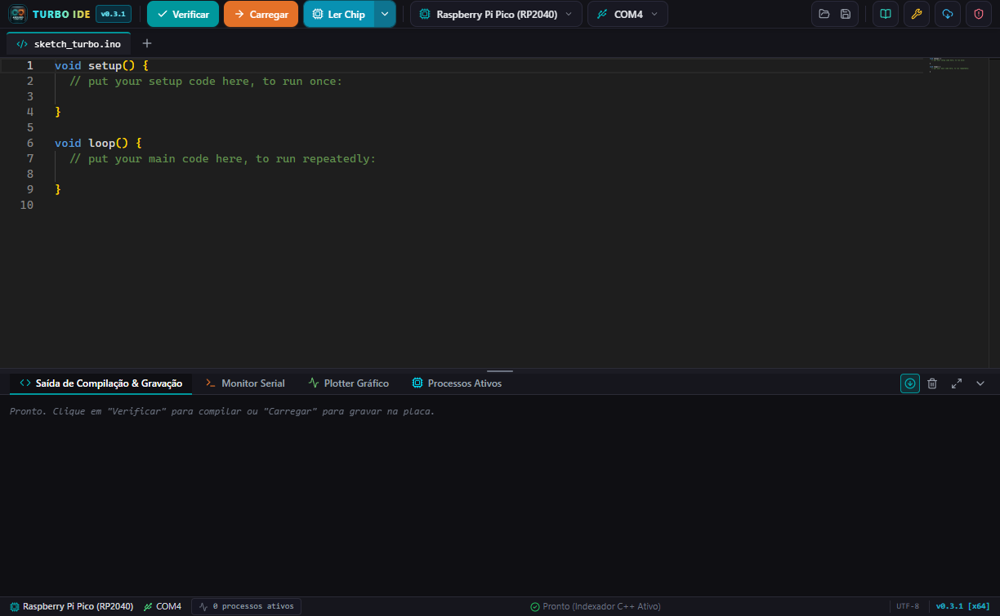
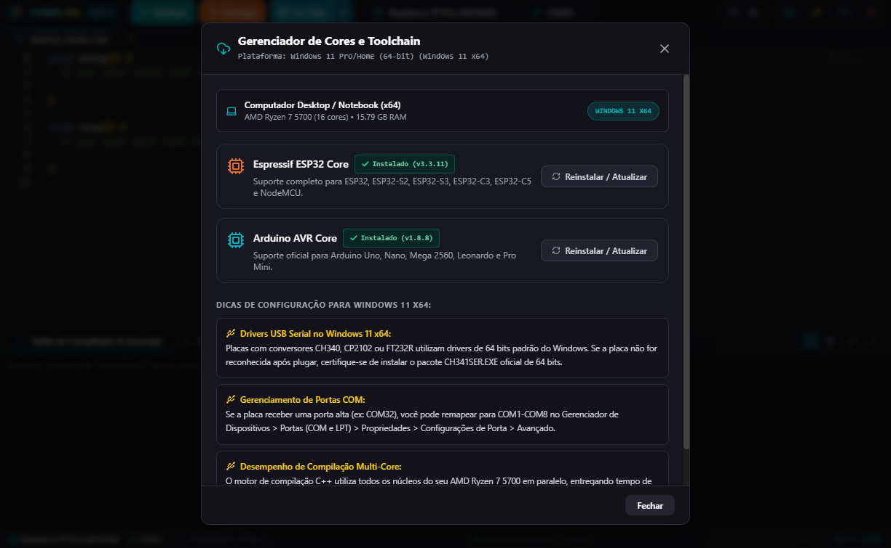
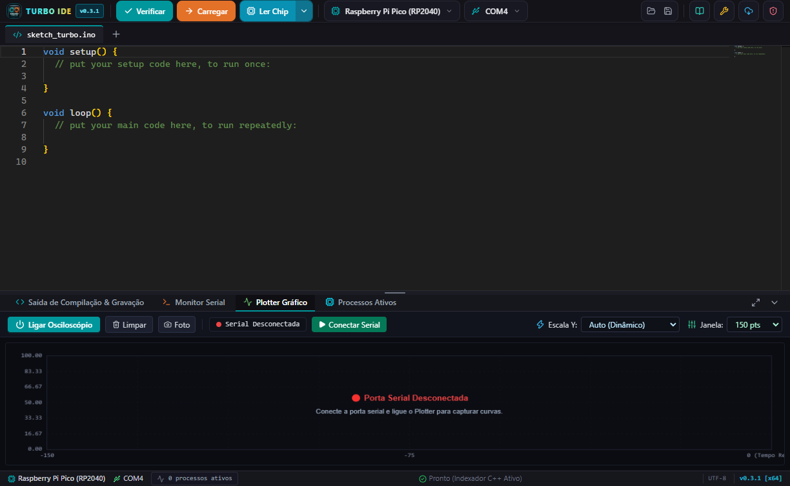
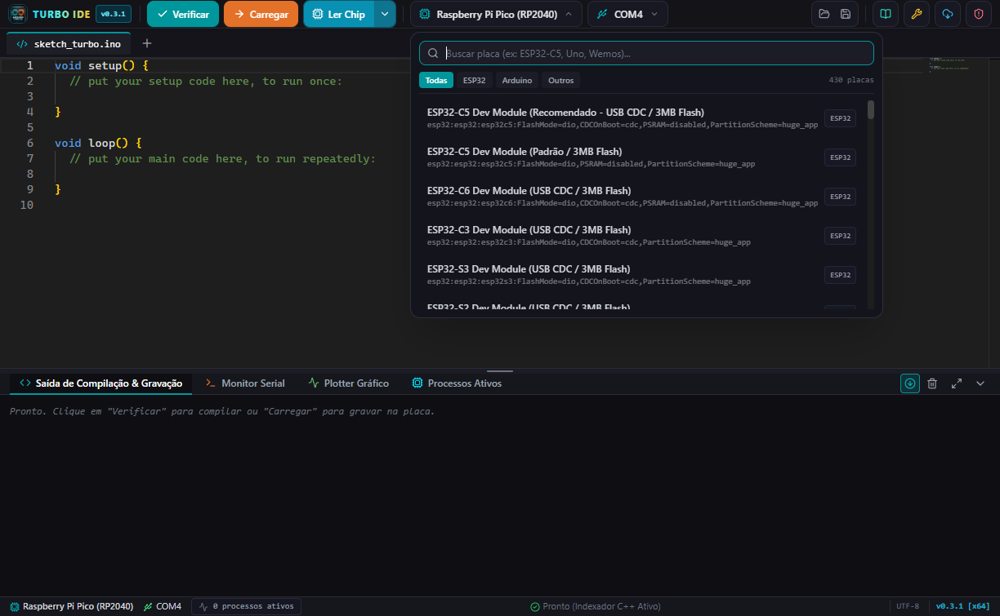

# Arduino Turbo IDE 🚀

**Arduino Turbo IDE** é um ambiente de desenvolvimento ultrarrápido, moderno e direto ao ponto, criado para eliminar a lentidão e a burocracia do Arduino IDE tradicional.

Projetado com suporte nativo de primeira classe para as arquiteturas **Windows ARM64** (Qualcomm Snapdragon) e **Windows x64** (Intel/AMD), com foco cirúrgico e otimização máxima para as duas maiores famílias de microcontroladores do mundo: **Espressif ESP32** e **Arduino AVR Oficial**.

  

---

## 🎯 Por que o Turbo IDE foi criado?

O **Arduino Turbo IDE** nasceu de uma dor real:
> *"O Arduino IDE oficial é muito lento, tem uma interface antiga, cheia de burocracias e é extremamente pesado. Em computadores portáteis como o **Samsung Galaxy Book Go (Windows ARM64)**, a experiência era terrível: demora extrema para abrir, travamentos ao digitar, lentidão para compilar e erros frequentes no upload de código por falta de suporte nativo."*

O objetivo do Turbo IDE é simples: **ser rápido, bonito, leve e ter todas as funções essenciais acessíveis diretamente na tela.**

Ele abre instantaneamente, detecta sua porta USB em menos de 300ms, compila com cache inteligente e grava no microcontrolador na velocidade máxima suportada pelo hardware.

---

## 📸 Demonstração Visual

| **Interface Principal & Monaco Editor** | **Gerenciador de Cores & Toolchain** |
| :---: | :---: |
|  |  |

| **Osciloscópio Digital & Plotter Serial (60 FPS)** | **Seletor Rápido de Placas (ESP32 & AVR)** |
| :---: | :---: |
|  |  |

| **Gerenciador de Bibliotecas Oficial** |
| :---: |
|  |

---

## 📥 Download & Instalação

Baixe a versão oficial mais recente:

👉 **[Baixar Instalador Universal (v0.3.1 Oficial)](https://github.com/ArthurA32/arduino-turbo-ide/releases/latest)**

* **Instalador Universal Inteligente (`Arduino_Turbo_IDE_Setup_Universal.exe`):**  
  Um instalador único que detecta a arquitetura do seu Windows em tempo real:
  * Em máquinas **ARM64** (como Galaxy Book Go, Surface Pro X) $\rightarrow$ Instala os binários AArch64 100% nativos, sem camadas de emulação lenta.
  * Em máquinas **x64** (Intel / AMD) $\rightarrow$ Instala a versão x64 de alta performance.
* **Instalação Silenciosa:** Atualizações e instalações suaves sem abertura de janelas pretas do Prompt de Comando (CMD).

---

## 🔌 Microcontroladores com Suporte Nativo Completo

O Turbo IDE é focado nas placas que os desenvolvedores mais utilizam no dia a dia, com configurações pré-otimizadas de fábrica (USB CDC, velocidade de Flash, esquemas de partição):

### 🔵 Família Espressif ESP32
* **ESP32-C5 Dev Module** (Otimizado com USB CDC / Flash DIO / 3MB App)
* **ESP32-C6 Dev Module** (Suporte a Wi-Fi 6, Zigbee e Thread)
* **ESP32-C3 Dev Module** (RISC-V de alta eficiência)
* **ESP32-S3 & ESP32-S2 Dev Module** (USB Nativo / CDC on Boot)
* **ESP32 Dev Module Clássico** (WROOM-32 / WROVER / ESP32-WROOM)
* **NodeMCU-32S**

### 🟢 Família Arduino AVR Oficial
* **Arduino Uno** (R3 / ATmega328P)
* **Arduino Nano** (ATmega328P - Suporte automático a Bootloader Novo e Antigo)
* **Arduino Mega 2560** (ATmega2560)
* **Arduino Leonardo** (ATmega32U4 com USB nativo)
* **Arduino Pro Mini** (5V e 3.3V)

---

## ⚡ Primeiro Uso: Guia Rápido de Inicialização

Ao abrir o **Arduino Turbo IDE** pela primeira vez:

1. **Abra o Gerenciador de Cores:** No topo da tela, clique no ícone da **Nuvem com a seta para baixo**.
2. **Instale os Cores Desejados:**
   * Clique em **Instalar Arduino AVR** (para usar Arduino Uno, Nano, Mega, etc.).
   * Clique em **Instalar ESP32** (para usar placas da linha ESP32).
3. **Aguarde o download:** É feito apenas uma vez.
4. **Pronto!** Selecione sua placa e porta COM na barra superior e comece a programar.

---

## 🌟 Funcionalidades Exclusivas

### 1. 🔄 Auto-Updater Global via GitHub Releases
* Verificação automática de novas versões diretamente da API pública do GitHub.
* Download com barra de progresso em tempo real (MB transferidos e porcentagem).
* Atualização com 1 clique: o instalador atualiza os arquivos e reinicia o aplicativo automaticamente.

### 2. 🔬 Leitor e Descompilador de Silício (Remapeador de Portas GPIO)
* **Dump de Memória Flash:** Leitura direta da Flash física via hardware pela porta serial COM (`esptool` / `avrdude`).
* **Descompilação:** Identificação estruturada de rotinas e strings contidas no firmware gravado no chip.
* **Remapeador Visual de GPIO:** Permite identificar portas e pinos configurados no firmware e reatribuir pinos diretamente no binário sem precisar do código-fonte original.

### 3. ⚡ Compilação Turbo com Cache Inteligente
* **Cache Persistente (`--build-path`):** Compilações subsequentes do mesmo projeto levam entre **0.8s e 2 segundos**, reaproveitando objetos já compilados.
* **Upload Otimizado:** Gravação via USB CDC a 921.600 baud com liberação segura de locks de porta serial.

### 4. 📈 Osciloscópio Digital & Plotter Gráfico (60 FPS)
* Plotter serial de alto desempenho renderizado em Canvas 2D a 60 quadros por segundo.
* Auto-Scale dinâmico, pausa de captura, exportação de gráfico e Crosshair HUD com valores instantâneos.

### 5. 🛡️ Auto-Healer de Bibliotecas
* Detecção automática de cabeçalhos `#include` faltantes durante a compilação.
* Injeção automática e resolução de bibliotecas populares (`BleKeyboard`, `ESPAsyncWebServer`, `AsyncTCP`, etc.).

---

## 📜 Histórico de Versões (Changelog Oficial)

### 🔹 [v0.3.1] - 2026-10-22 *(Lançamento Oficial Vigente)*
* **Auto-Updater Global via GitHub:** Migração completa do atualizador para a API pública do GitHub Releases.
* **Instalador NSIS Silencioso:** Eliminação de janelas de CMD piscando durante instalações e updates.
* **Unificação de Arquiteturas:** Sincronização estrita das builds x64 e ARM64 na mesma tag de release.
* **Identidade de Processo:** Registro PE como `Arduino Turbo IDE` no Gerenciador de Tarefas do Windows.

### 🔹 [v0.2.7 - v0.2.8] - 2026-09-07
* **Varredura Instantânea WQL:** Detecção de portas seriais reduzida de 2.500ms para menos de 300ms.
* **Auto-Detecção de Placas USB:** Identificação imediata de microcontroladores conectados.

---

## 🛠️ Tecnologias Utilizadas

* **Shell Desktop:** Electron 35 + Node.js
* **Frontend:** React 19 + TypeScript + Vite + Tailwind CSS
* **Editor de Código:** Monaco Editor (núcleo do VS Code) com IntelliSense nativo C++/Arduino
* **Engine de Embarcados:** Arduino CLI nativo (AArch64 e x64), esptool, avrdude, avr-objdump

---

## 🤝 Feedback e Suporte

Encontrou algum problema ou tem sugestões para as próximas versões?
* Abra uma [Issue no GitHub](https://github.com/ArthurA32/arduino-turbo-ide/issues).
* Todas as sugestões são analisadas e testadas diretamente na bancada de hardware!

---

## 👨‍💻 Sobre o Criador & Filosofia do Projeto

* **Criador & Idealizador:** **Arthur ([@ArthurA32](https://github.com/ArthurA32))**
* **Início do Projeto:** Desenvolvido originalmente em **2026**, motivado pelo desafio prático de rodar uma IDE moderna, ágil e estável no hardware ARM do **Samsung Galaxy Book Go**, sendo posteriormente expandido com núcleos nativos de alta performance para plataformas **Windows x64**.
* **Versão Vigente:** **v0.3.1 Oficial** (Build estável)
* **Distribuição:** **100% Gratuito** para toda a comunidade de desenvolvedores, estudantes e entusiastas de eletrônica.

### 🛡️ Engenharia com Proteções Internas de Hardware
O **Arduino Turbo IDE** foi arquitetado com mecanismos reais de proteção para garantir que tanto iniciantes quanto profissionais programem com tranquilidade absoluta:
* **Flash Mode DIO Universal (Anti-Bootloop):** Configuração nativa em modo DIO em vez de QIO. Placas com memórias flash genéricas ou de 2 vias gravam com total estabilidade, eliminando reinicializações infinitas (*bootloops*).
* **Auto-Healer de Estouro de Flash:** Se o sketch exceder o espaço padrão de 1.3MB, o compilador detecta o estouro automaticamente e expande o particionamento para **Huge App (3.14MB)** em tempo de execução, sem corromper o layout da memória.
* **Diagnóstico Inteligente de Chip Conectado:** Caso você selecione um modelo no seletor e conecte outro microcontrolador na USB (ex: selecionou ESP32-S3 mas conectou um ESP32-C3), o sistema detecta a divergência física e bloqueia a gravação incorreta, alertando qual placa está realmente conectada.
* **Prevenção de Kernel Panic (PSRAM Segura):** Acesso a PSRAM vem pré-configurado de forma segura para não disparar travamentos de kernel em placas que não possuem chip externo de RAM.
* **Liberação Automática da Porta Serial:** Antes de qualquer gravação ou leitura de chip, todas as conexões ativas do Monitor Serial e Plotter são fechadas instantaneamente, impedindo que o processo seja interrompido pela metade por locks do Windows.
